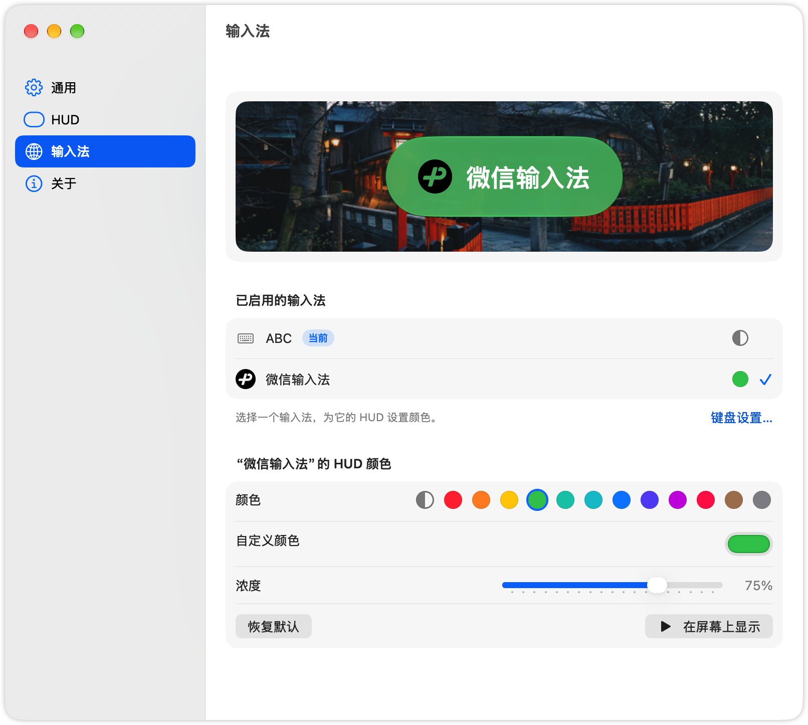

# InputSwitch

**English** | [简体中文](README.zh-CN.md)

A lightweight macOS menu bar app that shows a Liquid Glass HUD whenever your input source changes, so you always know which one is active. Built for anyone who flips between languages all day and wants to stop guessing what will come out of the keyboard.

> Inspired by [isHUD](https://github.com/ghawkgu/isHUD), rewritten from scratch in Swift.

<p align="center">
  
  
  
</p>

## Contents

- [Key Features](#key-features)
- [Installation](#installation)
- [Usage](#usage)
- [Settings](#settings)
- [Building from Source](#building-from-source)
- [Architecture](#architecture)
- [Releasing](#releasing)
- [Troubleshooting](#troubleshooting)
- [License](#license)

## Key Features

- **Liquid Glass HUD**: shows the input source icon and name on the active screen. Choose Liquid Glass or Solid style, three sizes (Small / Medium / Large), and three positions (Top / Center / Bottom). On macOS 26+ the glass follows the system's glass transparency setting; older systems fall back to a material background.
- **Per-source colors**: give each input source its own HUD tint and intensity, with a live wallpaper preview in Settings.
- **Menu bar menu**: pick an input source directly or open Settings. The menu bar icon can be hidden.
- **No special permissions**: InputSwitch only listens for the system's input source change notification, so it needs no Accessibility access.
- **Launch at login**, and localized into English, 简体中文, 繁體中文, and 日本語.

## Installation

### Requirements

- macOS 15.7 or later (Liquid Glass requires macOS 26 or later)
- Apple Silicon or Intel Mac (the release build is a universal binary)

### Download

1. Download the latest `inputswitch-X.Y.Z.dmg` from [GitHub Releases](https://github.com/e1roy/inputswitch/releases).
2. Open the DMG and drag **inputswitch** into **Applications**.
3. Launch it. The Settings window opens on first launch.

The DMG is not notarized. If macOS refuses to open it, see [Troubleshooting](#app-cant-be-opened-after-download).

## Usage

1. **Switch input source** the way you normally do (for example with the system's ⌃Space or 🌐 shortcut, or from the menu bar). The HUD appears on the active screen.
2. **Open Settings**: click the menu bar icon and choose **Settings…** (⌘,), or open InputSwitch again from Applications, Launchpad, or Spotlight. This also works when the menu bar icon is hidden.

## Settings

Settings uses a sidebar with four pages:

| Page | What you can configure |
|------|------------------------|
| General | Launch at login, show/hide the menu bar icon |
| HUD | Style (Liquid Glass / Solid), size, position, show icon, display duration (0.1–1.0 s, default 0.8 s), and a **Show on Screen** preview |
| Input Sources | Per-source tint color and intensity, with a live preview |
| About | Version and links |

Preferences are stored in `UserDefaults`. Per-source colors are keyed by the input source ID (`HUDTintsBySourceID`), so they survive renames and system language changes. Colors saved by older versions, which were keyed by name, are migrated automatically.

## Building from Source

### Prerequisites

- Xcode with the macOS 26 SDK or later (the project uses Swift 6 and Liquid Glass APIs)
- If `xcode-select` points at the Command Line Tools, prefix `xcodebuild` commands with `DEVELOPER_DIR=/Applications/Xcode.app/Contents/Developer`. `start.sh` does this for you.

### Clone

```bash
git clone https://github.com/e1roy/inputswitch.git
cd inputswitch
```

### Build, install, and run

```bash
./start.sh
```

You can run this script as often as you like. It:

1. Builds a Release configuration with `xcodebuild`
2. Quits any running InputSwitch and the legacy isHUD app
3. Removes isHUD (app, login item, preferences) if present
4. Replaces `/Applications/inputswitch.app` and unregisters stale copies from LaunchServices, so Spotlight and Launchpad open the new build
5. Launches the app

> **Note:** `start.sh` deletes the isHUD app and its preferences. Skip it and use Xcode if you want to keep isHUD.

Alternatively, open `inputswitch.xcodeproj` in Xcode and run the `inputswitch` scheme.

### Build only

```bash
xcodebuild -project inputswitch.xcodeproj \
    -scheme inputswitch \
    -configuration Debug \
    build
```

### Run tests

The unit tests use Swift Testing and cover settings persistence, HUD tint contrast, and color migration:

```bash
xcodebuild test -project inputswitch.xcodeproj -scheme inputswitch \
    -destination 'platform=macOS' -only-testing:inputswitchTests
```

### Scripts

| Script | Description |
|--------|-------------|
| `./start.sh` | Build Release, install to `/Applications`, remove isHUD, and launch |
| `./build-dmg.sh` | Build a universal (arm64 + x86_64) DMG into `dist/` |

## Architecture

### Tech Stack

- **Language**: Swift 6 (strict concurrency, default `MainActor` isolation)
- **UI**: SwiftUI + Observation; AppKit for the HUD `NSPanel` and Settings window
- **Input sources**: Carbon Text Input Sources (TIS) API
- **Tests**: Swift Testing
- **CI**: GitHub Actions (`macos-26` runner)

### How it works

`AppCoordinator` is the composition root. It creates every service and connects their callbacks. `AppDelegate` owns the coordinator and handles the app lifecycle.

```
InputSourceService ──selection changed──▶ HUDController
AppSettings / HUDAppearanceStore ◀── Settings UI ; read by HUDController
```

1. TIS posts a distributed notification when the input source changes, and `InputSourceService` publishes the new selection.
2. `HUDController` sizes, positions, and animates the `HUDPanel` on the active screen.

### Directory Structure

```
inputswitch/
├── App/
│   ├── InputSwitchApp.swift          # @main, menu bar scene
│   ├── AppDelegate.swift             # Lifecycle; reopening the app opens Settings
│   └── AppCoordinator.swift          # Composition root
├── Core/
│   ├── AppSettings.swift             # @Observable preferences backed by UserDefaults
│   ├── InputSourceService.swift      # TIS wrapper: list, observe, select
│   ├── HUDAppearanceStore.swift      # Per-source tints keyed by ID, with legacy migration
│   └── LoginItemService.swift        # Launch at login
├── HUD/
│   ├── HUDView.swift                 # HUDCard (Liquid Glass / Solid)
│   ├── HUDPanel.swift                # Floating, non-activating NSPanel
│   └── HUDController.swift           # Layout and animation
├── Settings/                         # Sidebar Settings window and pages
├── MenuBar/MenuBarContent.swift      # Menu bar dropdown
├── Support/Constants.swift           # HUD metrics, links, UserDefaults keys
└── Localizable.xcstrings             # en, zh-Hans, zh-Hant, ja
```

For the UI guidelines this project follows, see [docs/design-macos27.md](docs/design-macos27.md).

## Releasing

Pushing a tag of the form `vX.Y.Z` triggers [.github/workflows/release.yml](.github/workflows/release.yml), which builds the universal DMG and publishes a GitHub Release with the DMG and its SHA-256 checksum:

```bash
git tag -a v1.2.3 -m "InputSwitch v1.2.3"
git push origin v1.2.3
```

To rebuild an existing tag, run the workflow manually from the Actions tab and pass the tag.

To build a DMG locally:

```bash
VERSION=1.2.3 ./build-dmg.sh
```

- Output: `dist/inputswitch-<VERSION>.dmg`. Without `VERSION`, today's date (`YYYYMMDD`) is used.
- A `VERSION` of the form `X.Y.Z` also sets `MARKETING_VERSION` in the app.
- `CI=1` skips the Finder window styling, which needs a GUI session.
- The script deletes `build/` and `dist/` before it starts.

## Troubleshooting

### App can't be opened after download

Release builds are not notarized, so Gatekeeper may block them. Right-click the app and choose **Open**, or clear the quarantine flag:

```bash
xattr -dr com.apple.quarantine /Applications/inputswitch.app
```

### Spotlight opens an old build

Run `./start.sh`. It unregisters stale copies from LaunchServices. Release and DMG builds go into `*.noindex` folders so Spotlight doesn't index them.

## License

MIT License
